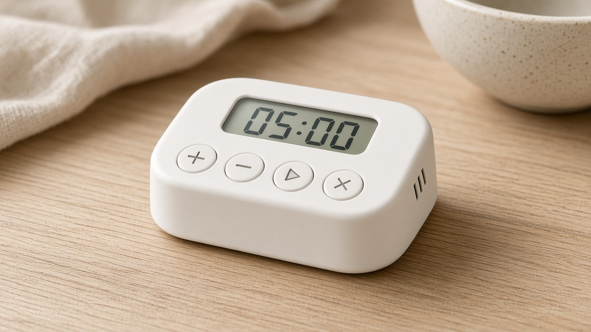

<!--
SPDX-FileCopyrightText: 2026 Elan8
SPDX-License-Identifier: MIT
-->

# Kitchen Timer

[](LICENSE)
[](https://www.omg.org/spec/SysML/)
[](https://github.com/elan8/spec42/releases/tag/v0.60.1)



A SysML v2 model of a stand-alone, coin-cell kitchen timer. The cook sets a countdown, reads the remaining time, hears completion, and replaces the cell without a tool. The model carries the requirements, the selected design, the baseline calculations, and the engineering documents.

The selected design is a reflective segmented LCD on a CR2032 cell, with no series regulator. On the reference day Spec42 evaluates about 47844 h of life, 37.2 g, and EUR 3.97, and the design checks pass. The longer plan for this repository, including a display trade-off that is not in the model yet, is the [implementation brief](docs/implementation-brief.md).

| Question | Where the model answers it |
| --- | --- |
| What does the cook need? | Five stakeholder requirements, `STK-001` through `STK-005` |
| What can the cook do? | Seven scenarios, `UC-01` through `UC-07` |
| What shall the timer do, and how well? | Twelve system requirements, `KT-FUN-001` through `KT-COST-001` |
| How is the selected timer built? | User interface, control, power, and the mechanical assembly, composed as `kitchenTimer` |
| Do the baseline numbers meet the limits? | Asserts on the integration for life, pulse current, timing, readability, loudness, envelope, mass, cost, cell replacement, and fit |
| How is that checked? | One analysis case, `VER-001` |
| Where is that written down? | Customer requirements, system requirements, system design, and the verification and validation plan |

## Model map

The textual model is the source. `Root.sysml` aliases `KitchenTimerSystem::kitchenTimer` as `systemOfInterest`.

| Path | Contents |
| --- | --- |
| `model/00_context/` | The cook and the timer |
| `model/10_usecases/` | Set, start, pause, cancel, alarm, dismiss, replace the cell |
| `model/20_requirements/` | Stakeholder needs |
| `model/50_library/` | Ports, the reference day, the milliampere unit |
| `model/60_systems/00_KitchenTimerSystem/` | System requirements, the selected integration, and `VER-001` |
| `model/60_systems/UserInterfaceSystem/` | Segmented LCD, four buttons, piezo sounder |
| `model/60_systems/ControlSystem/` | Microcontroller, 32.768 kHz crystal, board, firmware |
| `model/60_systems/PowerSystem/` | CR2032 cell and reservoir capacitor |
| `model/60_systems/MechanicalAssemblySystem/` | Enclosure, cell holder, battery door |
| `model/80_documents/` | Document views, prose, and the Elan8 house template |
| `project.md` | Tool versions, baseline assumptions, and the evaluated headline numbers |

## Check the model

Validation uses the Spec42 **0.60.1** release. That release bundles the SysML v2 standard library **2026-04** and the Elan8 domain libraries **0.5.0**. No extra library path is required.

```powershell
spec42 check model --workspace-root .
python scripts/validate.py   # the same check, failing on errors and unexpected warnings, as CI runs it
```

The check reports `view_type_non_standard` for the Elan8 context, specification, architecture, and integration views. Those views resolve. The warning says their definitions are not in the standard view table. Details and the baseline assumptions are in [`project.md`](project.md).

## Engineering documents

Four documents are views in [`model/80_documents/Documents.sysml`](model/80_documents/Documents.sysml). Tables, diagrams, and calculated values are read from the model.

| Document | Number | Answers |
| --- | --- | --- |
| Customer Requirements Specification | KT-CRS-001 | What does the cook need? |
| System Requirements Specification | KT-SRS-001 | What shall the timer do, and how well? |
| System Design Specification | KT-SDS-001 | How is the selected timer built? |
| Verification and Validation Plan | KT-VVP-001 | How is the baseline checked? |

From the repository root, with [Doc42](https://github.com/elan8/doc42) available:

```powershell
.\scripts\generate-documents.ps1
```

PDFs are written to `generated/` and are not committed. The script looks for Doc42 at `DOC42`, or at `../doc42/target/debug/doc42.exe`, and passes `../sysml-domain-libraries/model` so the document metadata resolves. A debug build can mint a seven-day development license when `ELAN8_LICENSE` is unset. A release build needs a real license. See [`model/80_documents/README.md`](model/80_documents/README.md).

## Continuous integration

[`.github/workflows/validate.yml`](.github/workflows/validate.yml) runs on every push and pull request. It validates the model with `scripts/validate.py` and Spec42 **0.60.1**, checks the four documents with Doc42 **0.6.0**, and builds them with the `ELAN8_LICENSE` repository secret. The PDFs are kept as the `documents` artifact of each run. On `main` they are also published to GitHub Pages with an index page, at <https://elan8.github.io/sysml-kitchen-timer/>.

## What this baseline leaves open

The model is one selected design, checked by analysis. It contains the board netlist (crystal, button pull-ups, piezo transistor) and does not yet contain display alternatives, a SPICE run, drawings, or firmware source. Alarm loudness is an estimate from a supplier rating, and the part costs are illustrative. Validation with a cook is described in the verification plan and is not a case in the model. Those next steps are set out in the [implementation brief](docs/implementation-brief.md).

## License

Licensed under the [MIT License](LICENSE).
